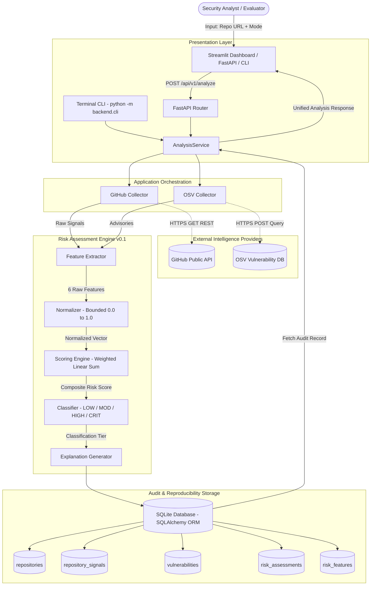

# APPLICATION ARCHITECTURE & SYSTEM DESIGN SPECIFICATION

**Project Title:** Assessing Open Source Dependency Risk Beyond Known Vulnerabilities  
**Project ID:** CYBER-100  
**Domain:** Cybersecurity and Blockchain Technology  
**Capstone Stage:** Engineering Capstone & Preliminary Design Review (PDR)  
**Standard Reference:** ISO/IEC/IEEE 42010 (Systems and software engineering — Architecture description)  

---

## 1. Architectural Overview & Design Principles

CYBER-100 is engineered using a modular, decoupled layered architecture. The system decouples external signal harvesting, feature engineering, mathematical scoring, persistent audit logging, and visualization layers.

### Key Architectural Principles
1. **Separation of Concerns (SoC)**: External collectors (`collectors/`), mathematical scoring logic (`risk/`), data persistence (`models/`, `database/`), and presentation (`api/`, `dashboard/`, `cli/`) operate behind clean interfaces.
2. **Transparent, Non-Blackbox Scoring**: Scoring rules are expressed as explicit mathematical weighted sums rather than opaque machine-learning models, ensuring full inspectability for faculty and evaluators.
3. **Reproducibility Guarantee**: Every executed assessment generates an immutable snapshot containing raw signals, normalized factors, weights, scoring version, and timestamp.
4. **Dual Execution Modes**: Real-time **LIVE DATA** mode connects to external APIs, while offline **DEMO FIXTURE** mode operates deterministically with zero network dependencies.
5. **Defensive Fault Isolation**: External API rate limits, timeouts, or network outages are caught at the collector boundary and logged as missing signals without causing application failure or producing false zero-risk results.

---

## 2. Mermaid Architecture & Data Flow Diagram



---

## 3. Subsystem Breakdown

### 3.1. Intelligence Harvesting Subsystem (`backend/app/collectors/`)
- **`GitHubCollector`**:
  - Validates and sanitizes repository URLs.
  - Harvests repository identity (stars, forks, watchers, open issues).
  - Calculates commit activity cadence ($C_{\text{month}}$).
  - Computes contributor governance metrics (contributor count, top contributor commit concentration ratio).
  - Computes release recency metrics (latest release tag, age in days, annualized frequency).
  - Handles HTTP 403 rate limits and HTTP 404 cleanly via `missing_fields` logging.
- **`OSVCollector`**:
  - Dynamically maps repository programming language to package ecosystem (Python $\to$ PyPI, JavaScript $\to$ npm, etc.).
  - Queries OSV API (`https://api.osv.dev/v1/query`) for published CVE/GHSA advisories.
  - Extracts CVSS scores, severity tags, affected ranges, and fixed versions.
  - Deduplicates records by unique `vuln_id`.

### 3.2. Risk Modeling Subsystem (`backend/app/risk/`)
- **`FeatureExtractor`**: Transforms raw collection dictionaries into 6 standard raw float values.
- **`Normalizer`**: Bounded mapping functions applying clamping ($[0.0, 1.0]$) to prevent outliers from distorting composite scores.
- **`ScoringEngine`**: Calculates weighted linear sum using versioned weights (`v0.1`).
- **`Classifier`**: Categorizes score into `LOW` ($<0.25$), `MODERATE` ($0.25-0.49$), `HIGH` ($0.50-0.74$), and `CRITICAL` ($\ge 0.75$).
- **`ExplanationGenerator`**: Formulates natural-language justifications highlighting primary risk drivers and bus-factor bottleneck indicators.

### 3.3. Persistence Subsystem (`backend/app/database/`, `backend/app/models/`)
- Fully normalized relational schema implemented in SQLAlchemy and SQLite.
- Foreign-key cascades guarantee clean data integrity.
- In-memory SQLite with `StaticPool` utilized for unit and integration testing.

### 3.4. Interfaces Subsystem
- **FastAPI REST API (`backend/app/main.py`)**: Endpoints for analysis, retrieval, and health monitoring.
- **Streamlit Analytical Dashboard (`dashboard/app.py`)**: Dual-mode interactive visualization with risk factor breakdown and academic limitation disclaimers.
- **Developer Terminal CLI (`backend/cli/`)**: Modern developer terminal CLI inspired by `driftctl` supporting interactive panels, `--json` streaming, and file export.

---

## 4. Execution Modes & Boundary

| Execution Mode | External API Calls | Deterministic | Primary Use Case |
| :--- | :---: | :---: | :--- |
| **LIVE DATA** | Yes (GitHub + OSV) | No (Signals evolve) | Operational dependency risk scanning |
| **DEMO FIXTURE** | No (Local JSON fixtures) | Yes (Identical byte-for-byte) | Faculty reviews, offline demonstrations, CI/CD regression tests |

---

## 5. Relational Database Schema Architecture

```
┌─────────────────────────┐         ┌─────────────────────────┐
│       repositories      │1       *│   repository_signals    │
├─────────────────────────┼─────────┼─────────────────────────┤
│ id (PK)                 │         │ id (PK)                 │
│ owner                   │         │ repository_id (FK)      │
│ name                    │         │ stars, forks, watchers  │
│ url (Unique)            │         │ open_issues             │
│ language                │         │ commit_frequency_month  │
│ license                 │         │ contributor_count       │
│ archived                │         │ top_contrib_commit_ratio│
└─────────────────────────┘         │ release_age_days        │
            │ 1                     │ missing_fields_json     │
            │                       └─────────────────────────┘
            │ 1
            ├───────────────────────┐
            │ *                     │ *
┌─────────────────────────┐         ┌─────────────────────────┐
│     vulnerabilities     │         │    risk_assessments     │
├─────────────────────────┤         ├─────────────────────────┤
│ id (PK)                 │         │ id (PK)                 │
│ repository_id (FK)      │         │ analysis_id (Unique)    │
│ vuln_id                 │         │ repository_id (FK)      │
│ severity                │         │ composite_score (Float) │
│ cvss_score              │         │ risk_level (String)     │
│ summary                 │         │ explanation_summary     │
│ fixed_versions          │         │ scoring_version         │
└─────────────────────────┘         │ is_demo_fixture         │
                                    └─────────────────────────┘
                                                │ 1
                                                │ *
                                    ┌─────────────────────────┐
                                    │      risk_features      │
                                    ├─────────────────────────┤
                                    │ id (PK)                 │
                                    │ assessment_id (FK)      │
                                    │ factor_name             │
                                    │ raw_value               │
                                    │ normalized_value        │
                                    │ weight                  │
                                    │ weighted_contribution   │
                                    └─────────────────────────┘
```

---

## 6. Error Handling & Security Boundary Architecture

1. **Client Boundary (`/api/v1/analyze`, `cli analyze`)**:
   - Empty or non-string input → `HTTP 400 Bad Request` / CLI exit code 2.
   - Non-GitHub URLs without demo flag → `HTTP 400 Bad Request` / CLI exit code 2.
   - Syntactically malformed URLs → `HTTP 400 Bad Request` / CLI exit code 2.
   - Truly non-existent repositories (GitHub 404) → `HTTP 404 Not Found` / CLI exit code 1.
   - Unhandled internal exceptions → Caught and logged; generic `HTTP 500` returned without leaking credentials.
2. **Database Boundary (`AnalysisService._persist_analysis`)**:
   - Wrapped in explicit `try ... except ... self.db.rollback() ... raise` blocks to prevent database corruption.
3. **Collector Boundary (`BaseCollector`)**:
   - Network timeouts set strictly to `settings.API_TIMEOUT_SECONDS` (10s max).
   - Missing fields recorded in structured arrays rather than silent null failures.
4. **Credential Protection**:
   - Secrets are masked with `***REDACTED***` across all error messages, logs, and CLI panels.
